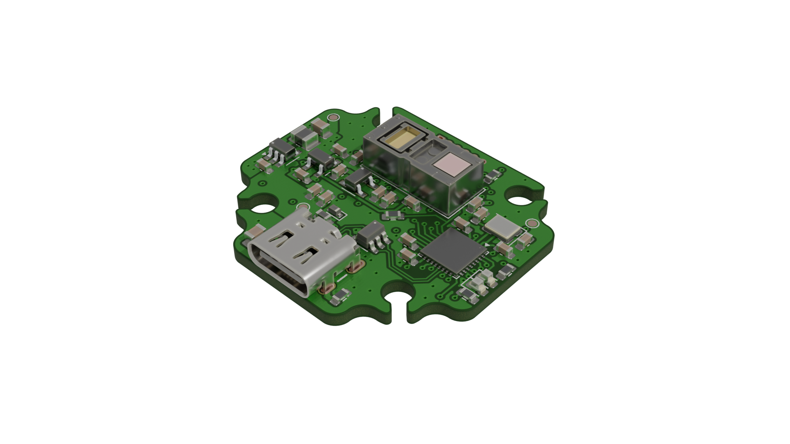
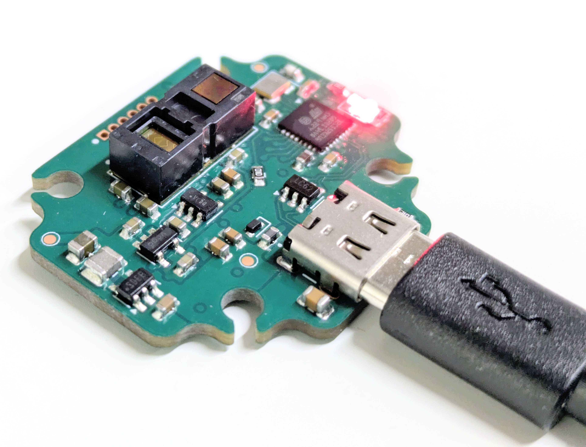
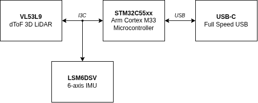
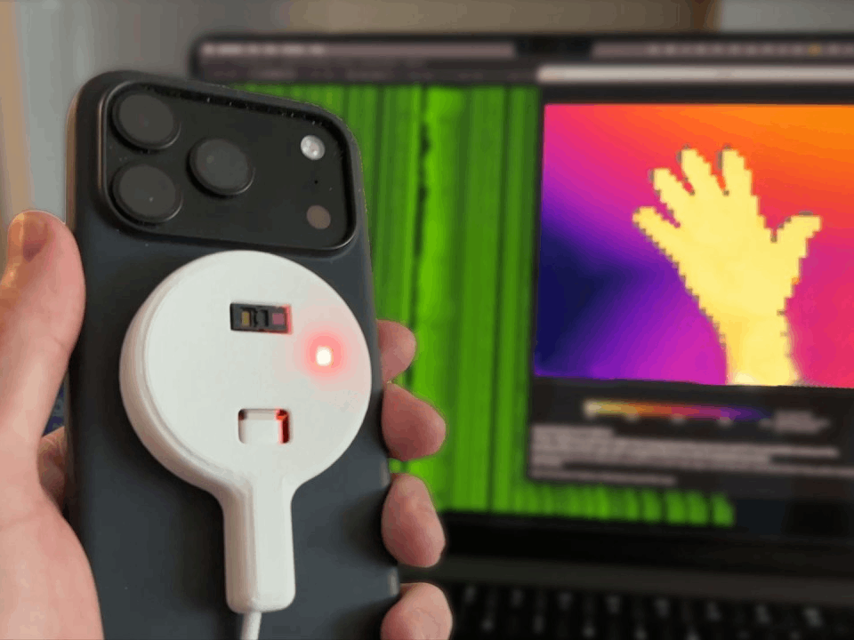
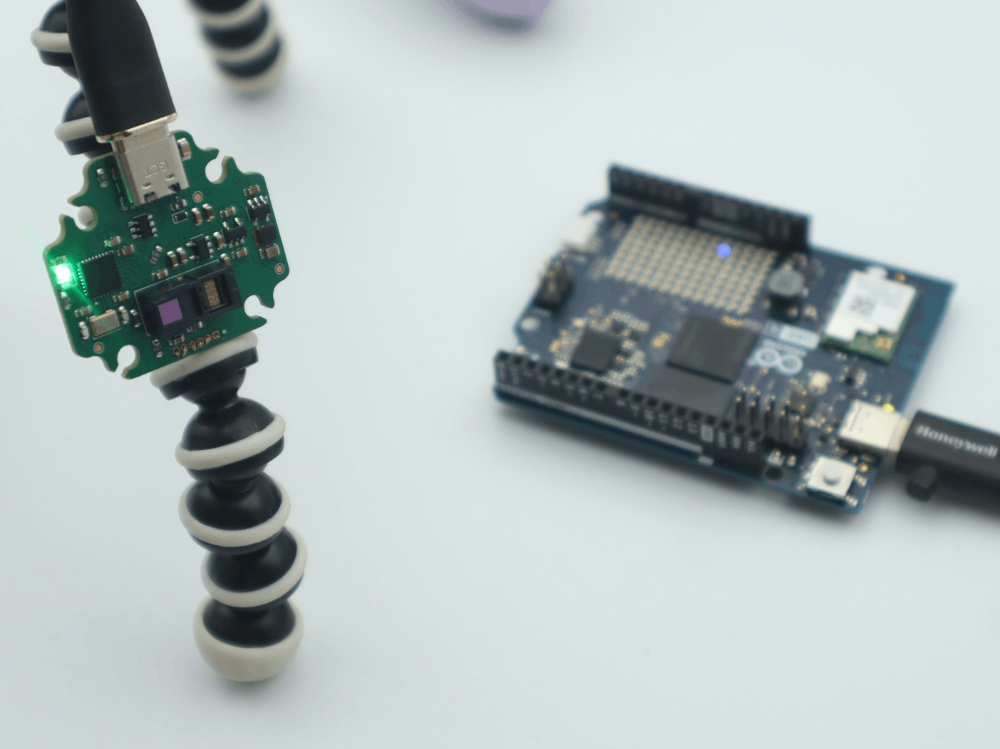

# USB-C LiDAR Node (VL53L9)

  
  

A compact and low-cost USB device with integrated LiDAR sensor and IMU. This hardware node packages STMicroelectronics' VL53L9 advanced direct Time-of-Flight (dToF) matrix LiDAR with a 6-axis IMU into a plug-and-play USB-C device. Designed for mobile robotics, micro-UAVs, and academic SLAM research. The hardware is designed in KiCad 10.

> [!NOTE]
> **Want a ready-to-use device?** I'm exploring the possibility of offering fully assembled and tested units. Interested? Star the repository to stay updated!

## Demo

  

The board comes with a browser app (Chrome/Edge, no installation besides Node.js for the dev server): live 3D point cloud, depth map and top view of the LiDAR, IMU graphs and 3D orientation of the board, stream statistics, and recording/playback of sessions. See [`application/README.md`](application/README.md).

## System Architecture

| Feature | Detail | Datasheet |
|---|---|---|
| **LiDAR** | ST VL53L9CX dToF module with up to 54×42 (2.3 k) discrete ranging zones, 5 cm–8.8 m range, 55°×42° field of view | [link](https://www.st.com/resource/en/datasheet/vl53l9cx.pdf) |
| **IMU** | ST LSM6DSV16BX 6-axis IMU (LSM6DSV and LSM6DSV16X are footprint-compatible and also supported by the firmware) | [link](https://www.st.com/resource/en/datasheet/lsm6dsv16bx.pdf) |
| **MCU** | ST STM32C552KEU6 (Cortex-M33, 144 MHz), USB Full-Speed device | [link](https://www.st.com/en/microcontrollers-microprocessors/stm32c5-series.html) |

## Repository Contents

| Folder | Contents |
|---|---|
| [`pcb/`](pcb) | KiCad 10 project: schematics, PCB layout, symbol and footprint libraries, 3D models (`pcb/3d/`). |
| [`pcb/production/`](pcb/production) | Fabrication outputs: Gerbers, BOM, pick-and-place positions, netlist and an interactive assembly guide. |
| [`firmware/`](firmware) | STM32C552 firmware (STM32CubeMX2 / CMake project): USB protocol, LiDAR and IMU drivers. See [`firmware/README.md`](firmware/README.md). |
| [`firmware/app/`](firmware/app) | Application code: USB protocol, LiDAR streaming, IMU detection, TinyUSB setup. |
| [`firmware/vendor/`](firmware/vendor) | Third-party code: TinyUSB, ST VL53L9 driver, ST IMU drivers (git submodules), HAL patch. |
| [`firmware/tools/`](firmware/tools) | `stream_check.py`: command-line check of the USB stream (rates, CRC, saves frames). |
| [`application/`](application) | Web app (TypeScript, Vite, Three.js): LiDAR and IMU visualization, recording, playback. See [`application/README.md`](application/README.md). |
| [`application/wasm/`](application/wasm) | ST's LiDAR processing library and the build script compiling it to WebAssembly. |
| [`doc/`](doc) | Datasheet, images and diagrams used in this README. |

## Getting Started

1. **Firmware**: clone with submodules (`git clone --recursive`), then build and flash with an ST-Link, see [`firmware/README.md`](firmware/README.md).
2. **Plug in** the board over USB-C. It enumerates as a USB serial device "USB LiDAR & IMU" (`cafe:4010`); the LED blinks.
3. **Web app**: `cd application && npm install && npm run dev`, open http://localhost:5173 in Chrome or Edge and click **Connect**, see [`application/README.md`](application/README.md).

## Data Format

The board is a USB CDC (virtual serial) device. Everything it sends is framed in compact binary packets, which keeps the LiDAR stream well within USB Full-Speed and costs the MCU almost nothing. The reference definition is [`firmware/app/protocol.h`](firmware/app/protocol.h).

| Offset | Size | Field |
|---|---|---|
| 0 | 2 | sync `0xA5 0x5A` |
| 2 | 1 | packet type |
| 3 | 1 | protocol version (1) |
| 4 | 4 | sequence number over all packets (a gap means a lost packet) |
| 8 | 8 | MCU timestamp, µs since boot |
| 16 | 4 | payload length *n* |
| 20 | *n* | payload |
| 20+*n* | 4 | CRC-32 (zlib) over header and payload |

All fields are little-endian.

| Packet | Rate | Payload |
|---|---|---|
| **LiDAR frame** | ~35 fps | Frame counter, 54×42, raw ST frame (14,842 bytes, ~520 kB/s) |
| **LiDAR calibration** | on request | The sensor's factory calibration (2,332 bytes), needed to turn raw frames into depth |
| **IMU sample** | 120 Hz | Acceleration (mg) and angular rate (mdps) on 3 axes, temperature (°C), as floats |
| **Status** | 1 Hz | Sensor states, frame/sample counters, dropped frames, errors |
| **Info / Log** | on connect / on events | Text: firmware version, sensors, serial number; messages |

Depth is computed on the host from the raw frames with ST's processing library and the sensor's own calibration. The web app does this in the browser (WebAssembly).

The host controls the board with single ASCII characters, so it can also be driven from a serial terminal. For example `L`/`l` turns the LiDAR stream on/off, `I`/`i` the IMU stream, `C` requests the calibration and `V` the device info.

| Measured performance (54×42 zones, I3C at 12 MHz) | |
|---|---|
| LiDAR frame rate | ~35 fps |
| IMU output data rate | 120 Hz |
| USB throughput | ~520 kB/s |

## Mechanical Specs

The PCB measures 34 × 30 mm and has 4×M3 mounting holes on a 20 mm square pitch, fitting small drone frame stacks.

## Example Projects

Projects from users of the board:

| Laan Labs: live 3D scanning with an iPhone | Rau7han: dashboard validated on an Arduino UNO Q |
|---|---|
|  |  |
| Laan Labs combined the board with an iPhone and ARKit for live 3D scanning: real-time meshing, colored point clouds and a scan of a whole apartment, with less than ~$50 of hardware. [Watch the video](https://www.youtube.com/watch?v=47Pw5VhnqPw). | Rau7han built firmware and a native dashboard for the sensor and validated the board with an Arduino UNO Q. The project is openly available: [Rau7han/VL53L9-UNO-Q-LiDAR](https://github.com/Rau7han/VL53L9-UNO-Q-LiDAR/tree/main). |

Built something with the board? Open an issue or pull request to have it added here.

## Acknowledgements

Special thanks to [Rau7han](https://github.com/Rau7han) for his support in this project. He was the first user of the board and validated it before I could: while I was still struggling with manual assembly, he already had a working app. His firmware served as the reference for the LiDAR bring-up in this repository.

## License

The hardware design and the project's own code are released under the [MIT License](LICENSE). Third-party components keep their own licenses:
- ST VL53L9 driver: BSD-3-Clause.
- ST IMU drivers: BSD-3-Clause.
- TinyUSB: MIT.
- ST's VL53L9 processing library (`application/wasm/vendor/`, compiled into the web app): ST SLA0111, for use with ST sensors only.

See the license files in the respective folders.
